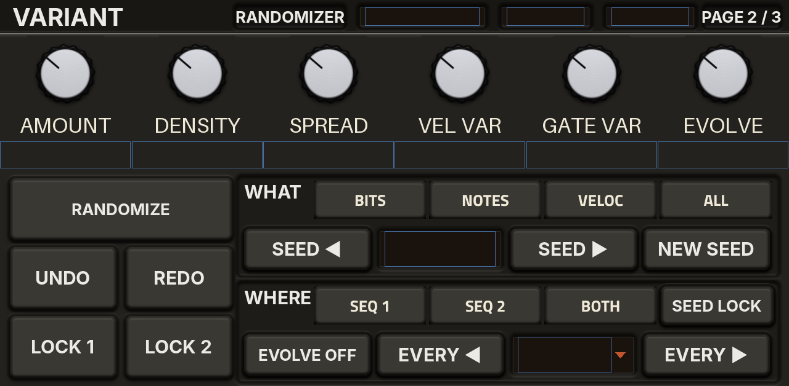

# VARIANT

Dual generative 8-step MIDI sequencer for the Akai Force / MPC OS (VST2, ARMv7 and aarch64 builds), by L'Cronx. It plays no sound of its own:
it sends notes to other tracks over MIDI. Two sequences, a bit pattern per step, a randomizer with undo/redo and seeds,
16 scales, chain mode and a pattern buffer. Built from a Max for Live device (Labyrinth) as the model; the panel is our own drawing.

**Status: 0.1.2, tested on the Akai Force only.** It is built for MPC OS 3.x. Tested by the author on an Akai Force, MPC OS 3.9.1 (see tested.json).
Both builds are released, but only the ARMv7 one has run on a device (the Force). The aarch64 build for Gen2 devices (MPC Live III and kin) is untested.

## What it does
- **Page 1 SEQUENCER**: TEMPO, CORR 1/2 (corrupt: mutates a sequence each time it wraps), RANGE 1/2 (octaves), EG MIX (velocity scale);
  RUN/STOP, TRIGGER, CHAIN SEQ (SEQ 1 then SEQ 2 as one 16-step line), BUFFER (ON saves the pattern, OFF recalls it), RESET, ADVANCE (plays the next step by hand, also when stopped);
  per sequence 8 step tiles with a playhead, LEN, SHIFT left/right, FLIP.
- **Page 2 RANDOMIZER**: AMOUNT, DENSITY, SPREAD, VEL VAR, GATE VAR, EVOLVE; RANDOMIZE, UNDO, REDO, LOCK 1/2; WHAT (BITS, NOTES, VELOC, ALL),
  SEED with previous/next/new, WHERE (SEQ 1, SEQ 2, BOTH), SEED LOCK, EVOLVE ON/OFF and EVERY (1 to 16 bars).
- **Page 3 PLAY / MIDI**: PROB 1/2, RATCHET, SWING, HUMAN, GATE; 16 SCALES and 12 ROOTS; per sequence MIDI channel, MUTE and RATE (1 to 1/32, triplets), RATE LINK.
- 128 factory presets; your own presets use MPC's normal preset saving (no slot limit).
- A MIDI note played into the track transposes the sequences (note minus middle C).

## MIDI output
MPC OS ignores MIDI that a plugin sends out, so VARIANT opens its own MIDI port, **VARIANT / MIDI Out**. In MPC, open Preferences > MIDI and
enable **Track** on that port, then choose it as the input of the tracks you want to play. See the [user guide](docs/USER_GUIDE.md).

## Install
Download from the releases, unzip, and follow `INSTALL.md` inside (needs root shell access):
- `VARIANT-0.1.2-mpc-armv7.zip`: Akai Force and the other first-generation devices. **Tested on a Force.**
- `VARIANT-0.1.2-mpc-aarch64.zip`: Gen2 devices (64-bit, MPC Live III and kin). **Not tested on a Gen2 device.**

## Build
`tools/gen_params.py`, `tools/gen_skin.py`, `tools/gen_presets.py` generate the parameters, skin and presets; `build.sh` compiles the engine and links it with the wrapper from
[mpc-vst-plugins](https://github.com/open-mpc/mpc-vst-plugins) (zig cc, glibc 2.31) for both targets, armv7 and aarch64. The panel layout is
`skin/layout.conf` with a numbered overlay and control table in `skin/layout_map/`.

## Pictures

(Skin previews: the live values and names are drawn by MPC on the device.)

## Licence
PolyForm Noncommercial 1.0.0 (see `LICENSE`): free to use, not for sale. The plugin wrapper belongs to its authors under their own licence.
